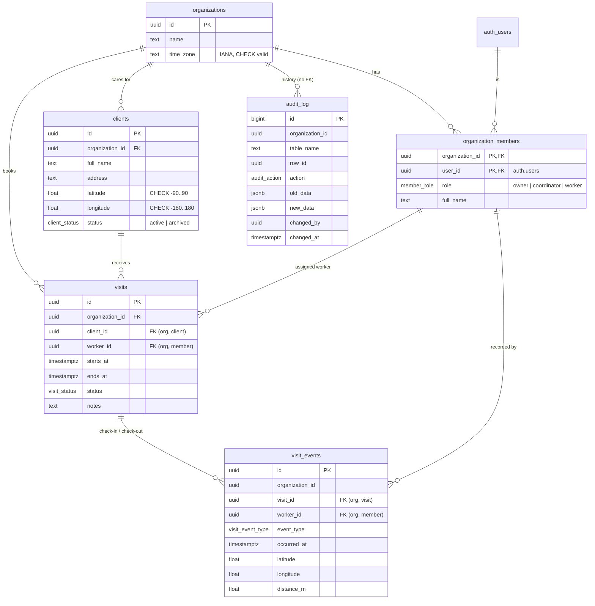

# Database schema

Postgres (Supabase) schema for the multi-tenant care-visit platform. Every business rule is enforced in the database. Migrations live in `supabase/migrations/`, and the tests that prove each rule are in `supabase/tests/`.

## Entity-relationship diagram

## Tables

### `organizations`
A home-care agency, which is the tenant.
- `time_zone` is an IANA zone name. The CHECK constraint `organizations_time_zone_valid` (via `private.is_valid_time_zone`) accepts only `Area/Location` names from `pg_timezone_names`, plus `UTC`. Abbreviations and fixed offsets such as `AEST` or `+10` ignore daylight saving, so they're rejected. Weeks in the hours report are counted in this zone.

### `organization_members`
A Supabase Auth user's membership and role in one organization. The primary key is `(organization_id, user_id)`, so a user can belong to several organizations, once each.
- `role`: `owner`, `coordinator` or `worker`.
- `full_name`: display name for colleagues, because `auth.users` isn't readable by the app.
- Index on `user_id` for the "which organizations am I in?" lookup that every RLS check makes.
- A member who has visits can't be removed, because `visits_worker_fk` is `ON DELETE RESTRICT`. Their visit history stays intact. Reassign or cancel their future visits first.

### `clients`
A person who receives care. They belong to one organization, and have a home address with latitude and longitude.
- `status`: `active` or `archived`. An archived client can't get new visits (trigger, error `CV001`).
- `unique (organization_id, id)` is the target of the composite FK from `visits`.
- **Can't be deleted while it has visits**: `visits_client_fk` is `ON DELETE RESTRICT`. Archive instead.

### `visits`
One booked visit.
| Constraint | Rule |
| --- | --- |
| `visits_client_fk` FK `(organization_id, client_id)` → `clients (organization_id, id)` | client is in the visit's organization; client with visits can't be deleted (rule 5) |
| `visits_worker_fk` FK `(organization_id, worker_id)` → `organization_members` | worker is a member of the visit's organization |
| `visits_ends_after_start` CHECK `ends_at > starts_at` | rule 4 |
| `visits_max_12_hours` CHECK `ends_at - starts_at <= 12 h` | rule 4 |
| `visits_no_overlap` EXCLUDE USING gist `(worker_id =, tstzrange(starts_at, ends_at, '[)') &&) WHERE status <> 'cancelled'` | rule 3, concurrency-safe ([ADR 0001](adr/0001-double-booking-exclusion-constraint.md)) |
| trigger `visits_enforce_rules` | rules 5 and 6, worker role, edit lock (below) |

Trigger `private.enforce_visit_rules()` (BEFORE INSERT OR UPDATE):
- a new visit must be `scheduled` (`CV004`)
- status moves only `scheduled → in_progress → completed` or `scheduled → cancelled` (`CV003`)
- `in_progress` needs a `check_in` event and `completed` needs a `check_out` event (`CV006`, `CV007`). Without this, a status UPDATE could skip the check-in rules and fake worked hours.
- only `scheduled` visits can change time, client or worker (`CV005`)
- no new visits for archived clients (`CV001`)
- the assignee must have the `worker` role (`CV002`)

The client and member lookups take `FOR SHARE` row locks. If a coordinator archives a client, or an owner changes a worker's role, at the same moment as a booking, one transaction waits for the other instead of both passing their checks.

`visits_no_overlap` is deliberately global rather than per organization. Someone who works for two agencies can't be in two homes at once either.

Indexes: `(organization_id, starts_at)` for the coordinator's week view, `(worker_id, starts_at)` for a worker's visits, and `(organization_id, client_id)` for the client FK. The exclusion constraint adds its own GiST index.

### `visit_events`
Check-in and check-out records, written only by `check_in` / `check_out` _(functions added in #4)_.
- Composite FKs keep the visit and the worker in the event's organization.
- `visit_events_one_per_worker_and_type` UNIQUE `(visit_id, worker_id, event_type)`: one check-in and one check-out per worker per visit. This also works for 2-worker visits in v1.1.0.
- `distance_m`: metres from the client's home when the event happened.

### `audit_log`
Append-only history of every insert, update and delete on `clients` and `visits` _(triggers and append-only guards added in #4)_.
- There are no foreign keys on purpose, so history survives deletion of the row it describes.
- `audit_log_data_matches_action` CHECK: insert has only `new_data`, delete has only `old_data`, and update has both.
- Index `(organization_id, changed_at desc)` for an owner browsing their organization's history.

## Error codes raised by the database

The web app maps these to user-facing messages and never shows the raw error.

| SQLSTATE | Constraint / source | Meaning |
| --- | --- | --- |
| `23P01` | `visits_no_overlap` | The worker already has a visit at that time |
| `23514` | `visits_ends_after_start`, `visits_max_12_hours`, others | Invalid value (end before start, over 12 hours, …) |
| `23503` | `visits_client_fk` etc. | Referenced row missing or still in use (e.g. deleting a client with visits) |
| `CV001` | `enforce_visit_rules` | Client is archived |
| `CV002` | `enforce_visit_rules` | Assignee is not a worker |
| `CV003` | `enforce_visit_rules` | Status change not allowed |
| `CV004` | `enforce_visit_rules` | New visit must start as scheduled |
| `CV005` | `enforce_visit_rules` | Only scheduled visits can be rescheduled or reassigned |
| `CV006` | `enforce_visit_rules` | Visit can't start without a check-in |
| `CV007` | `enforce_visit_rules` | Visit can't complete without a check-out |

## Who can do what (RLS)

Every table has row-level security enabled. Until the policies land in #4, no role except the database owner can read or write anything. `anon` has no table privileges at all.

_(Role-by-table matrix added in #4.)_

## Seed data

`supabase/seed.sql` contains fake data only and is loaded by `supabase db reset`. It is never pushed to a hosted project. It creates 2 organizations (Australia/Sydney and Europe/London). Each has 1 owner, 1 coordinator, 2 workers, 5 clients and 16 visits around the current date: 8 completed with check-in and check-out events, 2 cancelled, 1 in progress (checked in) and 5 scheduled. All seeded users sign in with `Password123!`, for example `coordinator@harbour.example` or `worker1@pennine.example`.
