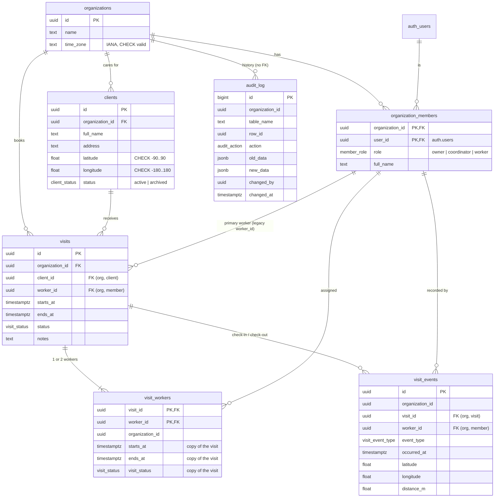

# Database schema

Postgres (Supabase) schema for the multi-tenant care-visit platform. Every business rule is enforced in the database. Migrations live in `supabase/migrations/`, and the tests that prove each rule are in `supabase/tests/`.

## Entity-relationship diagram

## Tables

### `organizations`
A home-care agency, which is the tenant.
- `time_zone` is an IANA zone name. The CHECK constraint `organizations_time_zone_valid` (via `private.is_valid_time_zone`) accepts only `Area/Location` names from `pg_timezone_names`, plus `UTC`. Abbreviations and fixed offsets such as `AEST` or `+10` ignore daylight saving, so they're rejected. Weeks in the hours report are counted in this zone.

### `organization_members`
A Supabase Auth user's membership and role in one organization. The primary key is `(organization_id, user_id)`, so a user can belong to several organizations, once each.
- `role`: `owner`, `coordinator` or `worker`.
- `full_name`: display name for colleagues, because `auth.users` isn't readable by the app.
- Index on `user_id` for the "which organizations am I in?" lookup that every RLS check makes.
- A member who has visits can't be removed, because `visits_worker_fk` is `ON DELETE RESTRICT`. Their visit history stays intact. Reassign or cancel their future visits first.

### `clients`
A person who receives care. They belong to one organization, and have a home address with latitude and longitude.
- `status`: `active` or `archived`. An archived client can't get new visits (trigger, error `CV001`).
- `unique (organization_id, id)` is the target of the composite FK from `visits`.
- **Can't be deleted while it has visits**: `visits_client_fk` is `ON DELETE RESTRICT`. Archive instead.

### `visits`
One booked visit.
| Constraint | Rule |
| --- | --- |
| `visits_client_fk` FK `(organization_id, client_id)` → `clients (organization_id, id)` | client is in the visit's organization; client with visits can't be deleted (rule 5) |
| `visits_worker_fk` FK `(organization_id, worker_id)` → `organization_members` | worker is a member of the visit's organization |
| `visits_ends_after_start` CHECK `ends_at > starts_at` | rule 4 |
| `visits_max_12_hours` CHECK `ends_at - starts_at <= 12 h` | rule 4 |
| `visits_no_overlap` EXCLUDE USING gist `(worker_id =, tstzrange(starts_at, ends_at, '[)') &&) WHERE status <> 'cancelled'` | rule 3, concurrency-safe ([ADR 0001](adr/0001-double-booking-exclusion-constraint.md)) |
| trigger `visits_enforce_rules` | rules 5 and 6, worker role, edit lock (below) |

Trigger `private.enforce_visit_rules()` (BEFORE INSERT OR UPDATE):
- a new visit must be `scheduled` (`CV004`)
- status moves only `scheduled → in_progress → completed` or `scheduled → cancelled` (`CV003`)
- `in_progress` needs a `check_in` event and `completed` needs a `check_out` event (`CV006`, `CV007`). Without this, a status UPDATE could skip the check-in rules and fake worked hours.
- only `scheduled` visits can change time, client or worker (`CV005`)
- no new visits for archived clients (`CV001`)
- the assignee must have the `worker` role (`CV002`)

The client and member lookups take `FOR SHARE` row locks. If a coordinator archives a client, or an owner changes a worker's role, at the same moment as a booking, one transaction waits for the other instead of both passing their checks.

`visits_no_overlap` is deliberately global rather than per organization. Someone who works for two agencies can't be in two homes at once either.

Indexes: `(organization_id, starts_at)` for the coordinator's week view, `(worker_id, starts_at)` for a worker's visits, and `(organization_id, client_id)` for the client FK. The exclusion constraint adds its own GiST index.

### `visit_workers` (v1.1.0)
The workers on a visit: 1 or 2, for 2:1 support. It's the source of truth for who is on a visit. `visits.worker_id` mirrors the primary worker for older clients (see [ADR 0002](adr/0002-multi-worker-visits-and-worker-id.md)).

| Constraint / trigger | Rule |
| --- | --- |
| PK `(visit_id, worker_id)` | a worker is on a visit at most once |
| `visit_workers_visit_fk` / `visit_workers_worker_fk` (composite) | same organization as the visit; deleting a visit removes its assignments |
| `visit_workers_no_overlap` EXCLUDE USING gist `(worker_id =, tstzrange(starts_at, ends_at, '[)') &&) WHERE visit_status <> 'cancelled'` | no double booking per worker, across all their assignments |
| `visit_workers_before_insert` | at most 2 workers (`CV050`, with the visit row locked), worker role (`CV002`), visit scheduled (`CV005`); copies the time and status from the visit |
| `visits_require_worker` / `visit_workers_require_worker` (deferred constraint triggers) | at least 1 worker at commit (`CV051`) |
| `visit_workers_before_change` | keys immutable (`CV052`); changes only while scheduled (`CV005`) |
| `visits_sync_workers` on `visits` | legacy insert or update of `worker_id` keeps the assignments right; time and status changes are copied to every assignment |
| `visit_workers_after_delete` | removing the primary worker makes the remaining worker `visits.worker_id` |
| `visit_workers_audit` | adding or removing a worker is audited (`row_id` = visit) |

Each assigned worker checks in and out separately. The first check-in sets the visit to `in_progress`, and the last assigned worker's check-out sets it to `completed`. `book_visit` / `update_visit` write a visit and its workers in one transaction (`security invoker`, so RLS applies).

### `visit_events`
Check-in and check-out records, written only by `check_in` / `check_out`.
- Composite FKs keep the visit and the worker in the event's organization.
- `visit_events_one_per_worker_and_type` UNIQUE `(visit_id, worker_id, event_type)`: one check-in and one check-out per worker per visit. This also works for 2-worker visits in v1.1.0.
- `distance_m`: metres from the client's home when the event happened.

### `audit_log`
Append-only history of every insert, update and delete on `clients` and `visits`, written by the `clients_audit` and `visits_audit` triggers.
- There are no foreign keys on purpose, so history survives deletion of the row it describes.
- `audit_log_data_matches_action` CHECK: insert has only `new_data`, delete has only `old_data`, and update has both.
- Index `(organization_id, changed_at desc)` for an owner browsing their organization's history.

## Error codes raised by the database

The web app maps these to user-facing messages and never shows the raw error.

| SQLSTATE | Constraint / source | Meaning |
| --- | --- | --- |
| `23P01` | `visits_no_overlap` | The worker already has a visit at that time |
| `23514` | `visits_ends_after_start`, `visits_max_12_hours`, others | Invalid value (end before start, over 12 hours, …) |
| `23503` | `visits_client_fk` etc. | Referenced row missing or still in use (e.g. deleting a client with visits) |
| `CV001` | `enforce_visit_rules` | Client is archived |
| `CV002` | `enforce_visit_rules` | Assignee is not a worker |
| `CV003` | `enforce_visit_rules` | Status change not allowed |
| `CV004` | `enforce_visit_rules` | New visit must start as scheduled |
| `CV005` | `enforce_visit_rules` | Only scheduled visits can be rescheduled or reassigned |
| `CV006` | `enforce_visit_rules` | Visit can't start without a check-in |
| `CV007` | `enforce_visit_rules` | Visit can't complete without a check-out |
| `CV010` | `check_in` | Not the assigned worker (or no such visit) |
| `CV011` | `check_in` | Visit isn't scheduled (already checked in, completed or cancelled) |
| `CV012` | `check_in` | More than 30 minutes before the start |
| `CV013` | `check_in` | After the scheduled end |
| `CV014` | `check_in` | Further than 200 m from the client's home (the message includes the distance) |
| `CV015` | `check_in` / `check_out` | Missing or invalid location |
| `CV020` | `check_out` | Caller didn't check in to this visit |
| `CV021` | `check_out` | Visit isn't in progress |
| `CV030` | `reject_audit_log_change` | Audit log is append-only |
| `CV040` | `guard_member_change` | Worker still has open visits (can't demote or remove) |
| `CV041` | `guard_member_change` | Organization must keep at least one owner |
| `CV042` | `guard_member_change` | Membership keys can't change in place |
| `CV043` | `prevent_organization_change` | Clients and visits can't move to another organization |
| `CV016` | `check_in` | You've already checked in to this visit |
| `CV022` | `check_out` | You've already checked out of this visit |
| `CV050` | `visit_workers` / `book_visit` | A visit has at most two workers (and at least one when booking) |
| `CV051` | deferred check | A visit needs at least one worker |
| `CV052` | `visit_workers` | Assignment keys can't change in place |
| `CV053` | `book_visit` / `update_visit` | Two different workers needed |
| `CV054` | `update_visit` | Visit not found or not editable |
| `42501` | RLS / privileges | Not allowed for this user |

## Who can do what (RLS)

Access has two gates. **Table privileges** come first: they are granted explicitly in `20261105174258_explicit_api_grants.sql`, because the hosted projects don't auto-grant new tables to the API roles. **RLS policies** come second.

Every table has row-level security enabled, and every policy targets `authenticated`. `anon` has no table privileges. All checks use `auth.uid()` from the verified JWT. An organization id sent by the client is never trusted on its own: it has to match a membership row of the caller.

| Table | Owner | Coordinator | Worker | Notes |
| --- | --- | --- | --- | --- |
| `organizations` | R | R | R | only organizations they're a member of |
| `organization_members` | R I U D | R | R | colleagues in their own organizations; **only owners manage members** |
| `clients` | R I U D | R I U D | R (own visits' clients) | workers see only clients on their own visits |
| `visits` | R I U D | R I U D | R (any visit they're assigned to) | workers change visits **only** via `check_in` / `check_out` |
| `visit_workers` | R I D | R I D | R (their visits' assignments) | no UPDATE; the copies are synced by trigger |
| `visit_events` | R | R | R (own) | inserted only by `check_in` / `check_out` (no INSERT/UPDATE/DELETE privilege) |
| `audit_log` | R | – | – | written only by triggers; **nobody** can update or delete it |
| `worker_weekly_hours` (view) | R (org) | R (org) | R (own hours) | `security_invoker`: inherits the `visit_events` policies |

R = select, I = insert, U = update, D = delete. Every I/U policy has a `with check`, so a row can't be written into, or moved to, an organization the user doesn't manage.

The policies call three `security definer` helpers in the non-exposed `private` schema. Each has `search_path = ''` and answers a question about the current user only, which avoids policy recursion between `visits` and `clients`:

- `private.is_member(org)`
- `private.has_role(org, roles[])`
- `private.is_worker_of_client(client)`

## Functions and views

| Object | Purpose |
| --- | --- |
| `public.check_in(visit_id, lat, lng)` | Rule 7. The caller must be the assigned worker, within 30 min before the start until the scheduled end, and within 200 m of the client's home (haversine). Locks the visit row, records a `check_in` event with the distance, and sets the visit to `in_progress`. |
| `public.check_out(visit_id, lat, lng)` | Rule 8. The caller must be the worker who checked in. Records a `check_out` event and sets the visit to `completed`. |
| `public.worker_weekly_hours` | Rule 10. Completed hours per worker per week: check-out minus check-in, grouped by Monday-start weeks in the organization's time zone. |
| `private.audit_row_change()` | Rule 9. An AFTER trigger on `clients` and `visits` that appends old and new values plus `auth.uid()` to `audit_log`. |
| `private.audit_member_change()` | Rule 9 extended. Membership inserts, role changes and removals are audited too (`row_id` = the member's user id). |
| `private.guard_member_change()` | Keeps open visits on workers, keeps at least one owner (locks the organization row), and makes membership keys immutable. |
| `private.prevent_organization_change()` | `organization_id` can't change on clients or visits, so a row (and its audit trail) never moves tenant. |
| `private.reject_audit_log_change()` | Rule 9. Rejects UPDATE, DELETE and TRUNCATE on `audit_log` (`CV030`) even for roles that bypass RLS. UPDATE, DELETE and TRUNCATE are also revoked from `authenticated` and `service_role`. |

Both RPCs are `security definer` with `search_path = ''`, and EXECUTE is granted to `authenticated` only. An unknown visit id returns the same error as another worker's visit, so ids can't be probed.

## Seed data

`supabase/seed.sql` contains fake data only and is loaded by `supabase db reset`. It is never pushed to a hosted project. It creates 2 organizations (Australia/Sydney and Europe/London). Each has 1 owner, 1 coordinator, 2 workers, 5 clients and 16 visits around the current date: 8 completed with check-in and check-out events, 2 cancelled, 1 in progress (checked in) and 5 scheduled. All seeded users sign in with `Password123!`, for example `coordinator@harbour.example` or `worker1@pennine.example`.
